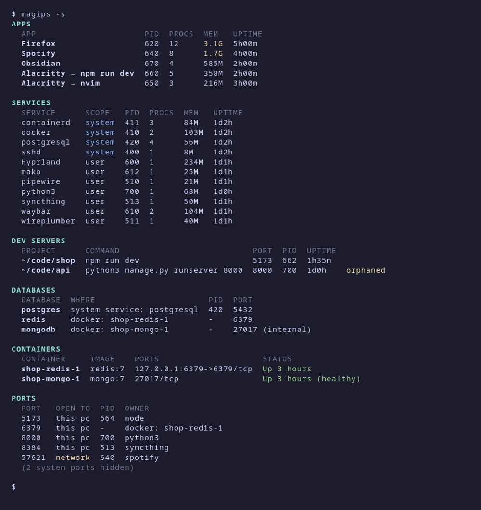

# magips

**What's running on my machine, and how do I stop it?** One command, no noise.

`htop` and `btop` show you 500 processes. magips shows the ~30 things you actually care about: your apps, the services under the hood, forgotten dev servers, databases, containers and open ports. Press `i` to see what something is before you stop it; each one has the right way to stop it built in.


## What it shows

| Section | What | Example |
|---|---|---|
| **Apps** | programs with a window, children rolled up | `Firefox  12 procs  3.1G` |
| **Services** | what runs under the hood: your desktop helpers and system services, minus the essentials | `waybar`, `pipewire`, `docker`, `postgresql` |
| **Dev servers** | your servers listening on a port, with the project they belong to | `~/code/api  python3 manage.py runserver  :8000  orphaned` |
| **Databases** | Postgres, MySQL/MariaDB, MongoDB, Redis… native or in Docker | `mongodb  docker: shop-mongo-1  27017 (internal)` |
| **Containers** | running Docker containers | `shop-redis-1  redis:7  Up 3 hours` |
| **Ports** | listening TCP ports, who owns them, and whether the network can reach them | `57621  network  spotify` |

`magips -s` prints all of it as tables:



## Install

Linux only. Needs a C compiler and `make`; no libraries beyond libc.

```sh
git clone <repo-url> magips && cd magips
make
make install PREFIX=~/.local     # or: sudo make install  (to /usr/local)
```

Docker is optional: without it, the Containers section is just empty.

## Usage

```sh
magips              # interactive picker
magips -s           # print the tables (also what you get when piping: magips | grep node)
magips --json       # everything as JSON, for scripts and status bars
magips --no-color   # plain output (NO_COLOR=1 works too)
```

### Keys

| Key | Does |
|---|---|
| `j` / `k` | move down / up |
| `h` / `l` | previous / next section |
| `g` / `G` | top / bottom |
| `/` | search: type to filter, `Enter` keeps the filter, `Esc` clears it |
| `i` / `Enter` | what is this? (see below); `d` from there stops it, `Esc` goes back |
| `d` | stop the selected thing (asks first) |
| `q` | quit |

Arrows, `Tab`/`Shift-Tab` and `Ctrl-n`/`Ctrl-p` work too.

### What is that thing?

`i` shows what you'd otherwise dig out with `ps`, `systemctl` and `docker inspect`, before you stop it:

```
docker  system service
  unit      docker.service — Docker Application Container Engine
  file      /usr/lib/systemd/system/docker.service
  on boot   disabled
  command   /usr/bin/dockerd -H fd:// --containerd=/run/containerd/containerd.sock
  started   1d16h ago by systemd (PID 1)
  procs     1: dockerd  (106M)

  status    systemctl status docker
  logs      journalctl -u docker -e
  stop      sudo systemctl stop docker
  for good  sudo systemctl disable --now docker
```

- **every process:** full command, program, working folder, who started it, how long ago, its processes and memory, and the ports it listens on
- **systemd units:** description, unit file, and whether it starts on boot
- **containers:** image, state, published ports, the compose file it came from, and its restart policy
- **ports:** which addresses it's bound to, and who owns it
- **commands:** to check its status, read its logs, and stop it yourself; each is the same thing magips would do

### What "stop" does

| You pick | magips does |
|---|---|
| an app, a dev server, one of your own services | sends `SIGTERM` to every process in the group, waits up to 3 s, and offers `SIGKILL` for anything still running |
| a container | runs `docker stop <name>` |
| a systemd user unit (pipewire, syncthing…) | runs `systemctl --user stop <unit>` |
| a system service (docker, postgresql…) | **prints** `sudo systemctl stop <unit>` for you to run, since killing it would just make systemd restart it |
| a port or a database | stops whatever runs it (for a dev server's port: just the dev server, not its terminal) |

Before each signal, magips re-checks the process's start time, so a PID that Linux has since given to a different program is never hit. If the group contains the terminal you're typing in, the confirmation says so.

### JSON

```sh
magips --json | jq '.dev_servers[] | select(.orphaned) | .project'
magips --json | jq '[.ports[] | select(.open_to == "network")]'
```

Top-level keys: `apps`, `services`, `dev_servers`, `databases`, `containers`, `ports`. Groups include the PIDs they're made of. `ports` also lists the system ports the table hides.

## Config

`~/.config/magips/config` is created on first run, and from then on it's the source of truth. One entry per line, `#` for comments, `*` and `?` as wildcards.

```ini
[hide-system]       # system services that are just "the machine working"
systemd-*
NetworkManager*
bluetooth

[hide-user]         # your desktop plumbing
xdg-desktop-portal*
at-spi*

[apps]              # programs without a .desktop file to list as apps
my-electron-thing
```

Delete the file to get the defaults back.

## How it works

Everything comes from files Linux already exposes. magips doesn't need root and runs no background process.

- **Processes:** `/proc/<pid>/stat`, `status`, `cmdline`, `exe`, `cgroup`, `cwd`.
- **Apps:** a process whose program matches an installed `.desktop` file (the same files app launchers use), and whose parent doesn't. That works on any desktop, compositor or X11. A terminal shows the job running inside it (`Alacritty → nvim`).
- **Services:** grouped by systemd unit (from the process's cgroup); otherwise by process tree.
- **Dev servers:** a process listening on a port that runs on a dev runtime (node, python, ruby, go, cargo…) or was started from a terminal. magips walks up to the top of the server (`npm run dev`, not the `node` it spawned), and reads the project folder from its working directory. "Orphaned" means the terminal it ran in was closed.
- **Ports:** `/proc/net/tcp{,6}`, matched to processes through the socket inodes in `/proc/<pid>/fd`.
- **Databases:** by process name, container image, or (marked with `?`) a standard port.
- **Containers:** `docker ps`.
- **Info panel (`i`):** the same `/proc` data, plus `systemctl show` for a unit's description and boot state and `docker inspect` for a container's compose file and restart policy, asked for only when you open it.

## Limits

- Memory is RSS, which counts shared memory once per process, so multi-process apps (browsers) look bigger than they are.
- Ports owned by other users (root, `postgres`…) need root to map to a PID. magips shows them through Docker where it can, and otherwise hides them from the table (they're still in `--json`).
- A terminal window shows only its newest shell's job.
- TCP only; no UDP.
- Docker only (no Podman yet).

## Development

```sh
make                # build ./magips
make test           # unit tests against a fake /proc in tests/fixtures
make DEBUG=1 test   # same, with AddressSanitizer + UBSan
make demo           # a fake machine to try things safely: source build/demo/env.sh
make gif            # re-record docs/demo.gif and docs/tables.png (needs vhs)
```

With `MAGIPS_PROC` pointing at a fake `/proc` (as in tests and the demo), magips never sends real signals; "stopping" only marks the fake process as gone.

| File | Job |
|---|---|
| `src/procfs.c` | read `/proc` |
| `src/tree.c` | parent/child links, which section owns each process |
| `src/desktop.c` | index `.desktop` files |
| `src/apps.c`, `services.c`, `devserver.c`, `db.c` | the sections |
| `src/ports.c`, `docker.c` | listening sockets, containers |
| `src/world.c` | one scan: everything above, in order |
| `src/report.c`, `report_json.c` | tables and JSON |
| `src/picker.c`, `actions.c` | the interactive picker and stopping things |
| `src/info.c` | the info panel: what something is, and the commands to check or stop it |
| `src/config.c` | the config file |

## License

[MIT](LICENSE)
